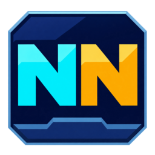

# NNBuild



NNBuild is one program for playing, hosting and building for **Duke Nukem 3D**
and other games made with the Build engine. It adds modern online play, a
built-in map editor, and mods written in JavaScript or TypeScript.

- **Documentation:** <https://nnb.nukemnet.com>
- **Downloads:** [latest release](https://github.com/aabluedragon/nnbuild/releases/latest)
  for Windows (64-bit and 32-bit), Linux (x64 and ARM64) and macOS (Apple
  silicon and Intel)
- **Feature list:** [FEATURES.md](FEATURES.md)

You bring your own copy of each game's data files; NNBuild supplies the program
that runs them.

## Disclaimer

NNBuild is entirely vibe-coded: everything it adds on top of NetDuke32 was
written by AI coding assistants. It is provided as is, with no warranty and no
liability of any kind. You use it at your own risk, and you are responsible
for how you use it.

## What it adds

- **Online play:** join a match that is already running, come back with your
  score if you drop out, find games in a server list, and get custom maps and
  mods sent to you automatically.
- **Server hosting:** a dedicated server with kick and ban, map rotation, live
  mod switching and scripts.
- **Several games in one program:** Duke Nukem 3D, Ion Fury, NAM, WWII GI,
  Shadow Warrior, Blood, Redneck Rampage and Exhumed/PowerSlave.
- **A built-in map editor** that several people, and AI assistants, can use on
  the same map at the same time.
- **Script mods** in JavaScript or TypeScript, with a project generator and
  breakpoint debugging in VS Code.

## Building

```sh
make nnbuild
```

This produces the program file `nnbuild` (`nnbuild.exe` on Windows).
Requirements for each platform, and the options used for the release builds,
are in
[Building from source](https://nnb.nukemnet.com/building/from-source.html).

The documentation site is in [`docs/`](docs) and is built with
[mdBook](https://rust-lang.github.io/mdBook/): `mdbook serve docs`.

## Where it comes from

NNBuild is a fork of [NetDuke32](https://voidpoint.io/StrikerTheHedgefox/eduke32-csrefactor),
which is part of the [EDuke32](https://www.eduke32.com) family. The other game
runtimes come from VoidSW (Shadow Warrior), NBlood/NotBlood (Blood), Rednukem
(Redneck Rampage) and PCExhumed (Exhumed/PowerSlave). The script engine is
[QuickJS-NG](https://github.com/quickjs-ng/quickjs). Thank you to everyone who
built those.

## Licence

The game code is under the GNU General Public License, version 2
([gpl-2.0.txt](package/common/gpl-2.0.txt)). The Build engine is under Ken
Silverman's Build licence ([buildlic.txt](package/common/buildlic.txt)). Other
bundled components carry their own licence files next to their source.

Duke Nukem 3D, Shadow Warrior, Blood, Redneck Rampage, PowerSlave, Ion Fury and
the other game names are trademarks of their respective owners. NNBuild is not
affiliated with or endorsed by them, and contains none of their game data.
