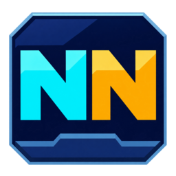

# NNBuild

  
  
NNBuild is one program for playing, hosting and building for
  <strong>Duke Nukem 3D</strong> and other games made with the Build engine.
  It adds modern online play, a built-in map editor, and mods written in
  JavaScript or TypeScript.

  <a class="primary" href="downloads.html">Download</a>
  <a href="getting-started/installing.html">Get started</a>
  <a href="features.html">See the features</a>

NNBuild is free and open source. It is based on NetDuke32, part of the EDuke32
family of community-made versions of the game. You bring your own copy of each
game's data files; NNBuild supplies the program that runs them.

> **Disclaimer.** NNBuild is entirely vibe-coded: everything it adds on top of NetDuke32 was
> written by AI coding assistants. It is provided as is, with no warranty and no
> liability of any kind. You use it at your own risk, and you are responsible
> for how you use it.

## What you can do with it

  

    <h3>Play online</h3>
    
Join a match that is already running, come back if you drop out, and
    get custom maps and mods sent to you automatically.

  

  

    <h3>Host a server</h3>
    
Run a dedicated server with map rotation, kick and ban, live mod
    switching and scripts.

  

  

    <h3>Build maps</h3>
    
Use the built-in editor, alone or with other people editing the same
    map at the same time.

  

  

    <h3>Write mods</h3>
    
Script the game in JavaScript or TypeScript, and debug with breakpoints
    in VS Code.

  

## Where to go next

| I want to... | Start here |
| --- | --- |
| Install and run a game | [Installing](getting-started/installing.md) |
| See which games work | [Supported games](games/overview.md) |
| Play with friends | [Playing online](multiplayer/playing-online.md) |
| Run my own server | [Dedicated server](multiplayer/dedicated-server.md) |
| Make a map | [Map editor overview](editor/overview.md) |
| Write my first mod | [Modding quick start](modding/quick-start.md) |
| Look up a launch option | [Launch options](reference/command-line.md) |
| Build the program myself | [Building from source](building/from-source.md) |

## About the name

NNBuild was called VibeBuild32 until recently. The program file is still named
`vibebuild32`, and you will see the old name in some file names and messages.
They are the same thing.
