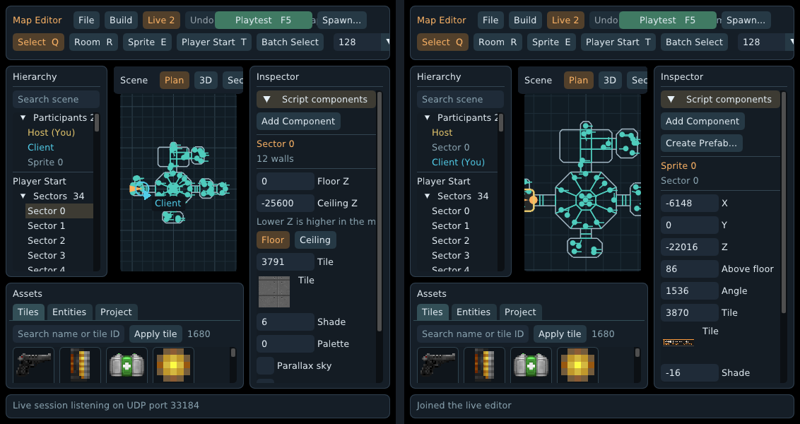

# Live editing

In a live session, several people edit the same map at the same time. One
person *hosts* the session from their editor. The others *join* it. Everyone
sees the map change as the others work.

A session holds up to 32 participants: the host and 31 others. An AI assistant
can take one of these places. See [AI and MCP](ai-and-mcp.md).



In the picture, the host is on the left and a second participant is on the
right. Both lists of **Participants** show two names. The host's Plan shows
the other participant's pointer with a name label.

## Requirements

- **The same version of NNBuild** on every machine.
- **The same game edition.** Everyone must run the same game data as the
  host, for example the Atomic Edition on all machines. AI participants are
  exempt.
- **A reachable UDP port on the host.** The session uses UDP port 23514 unless
  the host chooses another. Participants connect to the host's machine, so
  that port must be open in the host's firewall. To host across the internet,
  forward the port on the host's router to the host's machine.
- Every participant must be able to open the editor. See
  [Requirements](overview.md#requirements).

## Host a session

1. Open the map you want to share.
2. Click **Session** in the toolbar. The **Live editing** box opens.
3. Type a name in **Your name**. It may be up to 36 characters long.
4. Check **Host port**. Leave it at 23514 unless you need another port.
5. Click **Host this map**.

The status line says "Live session listening on UDP port 23514". The
**Session** button now reads **Live 1**. The number counts the participants.

Tell the others your address. If you changed the port, tell them the port too.

## Join a session

1. Click **Session** in the toolbar.
2. Type a name in **Your name**.
3. Type the host's address in **Host address**.
4. Click **Join session**.

| Address form | Example |
| --- | --- |
| Name or IPv4 address, default port | `192.168.1.20` |
| Name or IPv4 address with a port | `192.168.1.20:33184` |
| IPv6 address, default port | `[fe80::1]` |
| IPv6 address with a port | `[fe80::1]:33184` |

Joining replaces the map in your editor with the host's map. If your map has
unsaved changes, the editor asks you to save or discard them first.

While the editor connects, the box shows **Cancel connection**. When you are
in, the status line says "Joined the live editor". The shared map is called
`Live draft.map` on your machine.

## What you see of the others

**In the Hierarchy.** A **Participants** list appears at the top. Each name is
shown in that participant's colour. Your own entry is marked "(You)". An AI
participant is marked "(AI)". Under each other name is what that person is
doing:

| Text | Meaning |
| --- | --- |
| Plan view, 3D view | Nothing selected, in that view |
| Sector 5, Wall 12, Sprite 3, Player Start | The object they have selected |
| Moving Sprite 3 | They are dragging that object |
| Drawing a room | They are using the Room or the pillar tool |
| Placing sprites | They are using the Sprite, catwalk or prefab tool |
| Placing the start | They are using the Player Start tool |
| Playtesting | They are in a playtest |

**In Plan.** Each participant's pointer is drawn in their colour with a name
label. The object they have selected is outlined in the same colour. A
participant who is in the 3D view appears as a small ring at their camera
position.

**In 3D.** The pointers of other participants who are also in 3D are drawn in
your view. A small floor plan in the top right corner, the *live plan*, shows
everyone's pointers and selections and your own camera. Click **Live plan**
above the Scene to hide it or show it again.

**In the status line.** After each change by someone else, the status line
shows who did what, for example "Dana · Draw room".

## How edits are shared

Each finished action is sent as one edit.

- A drag is sent when you release the mouse button.
- A number typed in the Inspector is sent when you press **Enter**.
- A tool such as **Extend room** or **Create stairs** is sent when it
  completes.

The host checks every edit, gives the map a new revision number, and sends the
result to everyone.

While the host confirms your edit, the editor does not accept another one from
you. This normally takes a moment.

## When two people edit at once

The editor compares the map piece by piece: each sector, each wall, each
sprite, and the player start.

**Edits that merge.** If two people change different pieces at the same time,
both edits are kept. For example, one person retextures a wall while another
moves a sprite.

**Edits that conflict.** Your edit is refused when:

- someone else changed the same piece first, in a different way, or
- the number of sectors, walls or sprites changed while you were making your
  edit, or your own edit adds or removes them, or
- your edit was made on a map that is more than 24 revisions old.

When an edit is refused, your editor shows the latest shared map and this
message:

```text
The host changed the same map records first. Review the live draft and retry.
```

Nothing is lost on the shared map. Look at the current map and make your
change again.

When someone adds or removes sectors, walls or sprites, the numbers of other
objects can shift. Your selection and your batch group are cleared when that
happens.

## Change history and shared undo

Choose **Build → Change history** to see the last 24 changes of the session.
The newest is at the top. Open a change to see:

- the name of the person who made it, in their colour, with "(AI)" for an AI
  participant,
- the revision number,
- "Structure updated" if it added or removed sectors, walls or sprites,
- the objects it touched. Click one to bring it into view.

**Undo and redo are shared.** **Undo** takes back the most recent change of
the session, whoever made it. This includes changes made by an AI participant.
**Redo** brings it back. Both appear in the history as changes of their own,
such as "Undo Draw room".

The session keeps up to 24 undo steps. The undo history you had before the
session is not available while you are in it.

## Save and playtest during a session

- **Save.** Saving writes a copy on your own machine. It does not affect the
  others. A joined participant's `Live draft.map` has no file yet, so the
  editor asks for a name the first time.
- **Playtest.** Press **F5** as usual. The playtest runs only on your machine.
  The others keep editing and see "Playtesting" beside your name.
- **Another map.** The host can open another map or start a new one. This
  replaces the shared map for everyone. A joined participant must leave the
  session first to open a different map.
- **Classic Build tools.** See
  [Classic Build tools](classic-build-tools.md#in-a-live-session).

## Projects in a session

A session shares the map: its sectors, walls, sprites and player start. It
does not send project files.

- Give every participant the project, for example as a
  [project ZIP](projects.md#export-a-project-zip), so that they all have the
  same art and scripts.
- Script component attachments are kept by the host's project. Only the host
  can place a prefab that has script components.

## End a session

- **Leave.** A joined participant clicks **Session**, then **Leave session**.
  The map stays open in their editor as it was at that moment.
- **Stop hosting.** The host clicks **Session**, then **Stop hosting**. The
  others are disconnected and keep their copy of the map.

Returning to the title menu also leaves the session.

## Messages you may see

| Message | Likely reason |
| --- | --- |
| The editor host did not answer. Check the address and open slots. | The address or port is wrong, the port is blocked, or the session is full. |
| Could not resolve the editor's address. | The address is mistyped. |
| Select the same Duke3D edition as the host. | Your game data differs from the host's. |
| Disconnected from the editor host. | The host stopped the session, the connection dropped, or the two programs are different versions. |
| Could not listen on that UDP port. | Another program uses the port. Choose another **Host port**. |
| Wait for the host to confirm the current edit. | Your last edit is still on its way. Try again in a moment. |
| Leave the live session to open a different map. | Only the host can change the shared map. |
