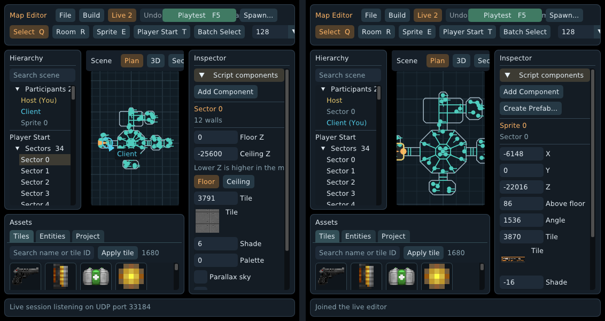

# Map Editor

Open **Map Editor** from the NNBuild title menu. To open it directly, run
the game with `--editor`. You can include a map path and select your Duke3D
data archive in the same launch.

```sh
./nnbuild -gamegrp /path/to/DUKE3D.GRP --editor
./nnbuild -gamegrp /path/to/DUKE3D.GRP --editor "My Map.map"
```

## Edit a map

- **Scene** shows the floor plan or a textured 3D view. In **Plan**, scroll to
  zoom, right-drag to pan, and drag selected geometry or sprites to move them.
  Click just inside either sector along a shared wall to select that sector's
  side of the portal. Hold Ctrl to select a wall among nearby sprites or
  vertices. Hold Shift when clicking to select a sector directly.
  Press **F** to frame the selection. In **3D**, hold the right mouse button
  to look and use **WASD** to fly and **Q/E** to move vertically. Click a surface
  or sprite to inspect it.
- **Room** (**R**) places corners on the snap grid. Click the first corner or
  press Enter to finish, or press Escape to clear the outline. Matching edges
  connect adjoining rooms. Select a solid wall and use **Extend room** to build
  from it, or **Split at midpoint** to add a vertex. Use **Select** (**Q**) to
  resume selecting objects. Press **Delete** to remove a selected sector or sprite.
- **Assets** contains the game's tiles and common Duke3D entities. Choose a
  tile and click **Apply tile** to assign it to the selected surface or sprite.
  Click an entity and place it in a sector. **Sprite** (**E**) places the
  current brush. Use **Player Start** (**T**) to set Duke's spawn point.
- **Inspector** edits heights, textures, sprite transforms, and Build tags
  and flags. Expanded sections stay open as you select other objects of the
  same type. Press Enter to commit a typed number. Use **Ctrl+Z** and
  **Ctrl+Shift+Z** to undo and redo.

## Build at different heights

- Select a sector and choose **Build → Draw pillar**. Draw a closed outline
  inside the sector and press Enter. This creates a solid inner wall loop.
- Select a solid wall with Ctrl-click in Plan and choose **Build → Stairs**.
  Enter the step count, tread depth and rise per step. A positive rise climbs
  from the selected wall. The flight uses adjoining classic sectors.
- Choose **Build → Catwalk**, select a tile and set its dimensions and
  height, then click **Place in Plan** and pick its center. Allow 48 units
  of clearance on both sides of the platform. The tile becomes a
  floor-aligned sprite that players can walk on or pass under.
- Use **Section** to see floor and ceiling profiles, catwalk clearance, and
  lift travel. **Pick cut** positions the section in Plan. Click a level in
  Section or use **All floors** in Plan to filter what you see and select.

## Link mechanisms

Choose a preset in **Build → Linked mechanisms** for Duke3D 1.3D and Atomic.
Select the target sector in the preset window. For a lift, select two
neighboring stops with different floor heights and align the platform
floor to either one. Ctrl-click a solid wall in Plan or select it in 3D,
then click **Add selected wall** to mount a switch. Repeat for call buttons
at both stops. Ceiling doors use an adjoining ceiling height, crusher
traps use a shootable trigger, and lighting switches use the chosen shade
and palette.

**Create linked mechanism** generates classic tags, sprites and sector
settings in one undoable change. **Build → Show links** draws the links in
Plan and in the 3D overview. Inspect the affected objects to edit their raw
Build values.

## Batch edits and map checks

Turn on **Batch Select** and click sprites or Ctrl-click walls to toggle
them in the group. In Inspector, enter a movement offset, adjust shade,
align a continuous run of solid walls using the same tile, or set sprite
height above each room’s floor. For example, a height of 40 positions a
centered switch around eye level. Each button applies one undoable edit.

**Build → Check map** shows orphaned switch links, cramped starts, missing
tiles and scripts, and compatibility findings for the selected target.
Click the affected object's name to frame it in Plan. Load the target
game and project art to verify tile availability.

## Playtest and save

Press **F5** to playtest the draft using the game's normal single-player
simulation. Press **F5** again or choose **Return to Editor** in the pause
menu. The editable map retains its geometry, sprite placements, and undo
history, view and selection when the playtest ends. Right-click a floor in
Plan or 3D and choose **Play From Here** to use a temporary spawn. In Plan,
**Play on catwalk** chooses a platform under the pointer. Use **Spawn...**
beside Playtest to choose **Map start** or a labeled DukeMatch or co-op
start.

Use **Ctrl+O** to open an existing map or select a level from **Maps in game
data**. Use **Ctrl+S** to save and **Ctrl+Shift+S** to save a copy. The editor
saves classic version 7 `.MAP` files within the selected game's tile range
and the limits of 1,024 sectors, 8,192 walls, and 4,096 sprites. The workspace
requires SDL2 and OpenGL.


## Native Build tools

Choose **File → Open Build tools** to open the same draft in the native editor
included in NNBuild. Use its 2D and 3D commands for operations such as
sector splitting and joining, wall alignment, loops, slopes, sprite
ornamenting, and Mapster scripting. Save the draft and exit to apply the
changes in the modern workspace. In a live session, the workspace can merge
independent edits made while the native tools were open. If changes conflict,
the status line gives the path to the saved native draft.

Open the native tools directly with `./nnbuild --build-editor file.map`.
Use a classic version 7 map to move a draft between the two workspaces.

## Projects and game compatibility

Use **Assets → Project** to create or open a project folder. Add maps, scripts,
textures, and other files by copying them into the folder or using **Add
asset**. Double-click a map to open it. Select a map and choose **Set entry map**
to choose where a player starts when they launch the project.

The project settings set the default base game and whether NNBuild
features are enabled. **File → Map settings** can override either setting
for the current map. Save the map to persist its options alongside it. The
**Import as** picker in **Open map** sets the target when opening a map from
another game. The browser shows the effective game icon beside each asset. The supported
targets are Duke Nukem 3D 1.3D, Duke Nukem 3D Atomic or Plutonium, NAM, NAPALM,
WWII GI, and Standalone. Use the selected game's own tiles, tags, and assets
when authoring for that game. Changing the target keeps the Build record
values, including tile IDs and tags.

Use **Export MAP** for a classic map and **Export ZIP** to pack a project
folder with its settings and assets. **Import ZIP into folder** unpacks a
project into a new folder. A player can drag the ZIP onto the executable or
pass it as a positional argument. They can pass a folder with `--project`
and use `--editor` to open it for editing.

```sh
./nnbuild "My Project.zip"
./nnbuild "My Project.zip" --project-map "Maps/Outpost.map"
./nnbuild -j/path/to/game-data --editor --project "/path/to/My Project"
```

An edition-dependent project uses the player's installed game archive.
Standalone projects supply their own `GAME.CON`, `tiles000.art`,
`palette.dat`, and any further resources their game uses. The in-place
playtest uses the data loaded by the current game instance.

### Modern Mode

Choose **File → Project → Enable Modern Mode** and confirm the compatibility
warning. A modern project requires NNBuild. Individual maps can also
choose **Inherit**, **Off**, or **On** in **Map settings**.

Select an entity or sprite and choose **Inspector → Script components →
Add Component**. Select a project script or create a JavaScript or TypeScript
component from a template. Repeat the action to attach multiple components
to one object. Sectors and walls can also have components.

Each module can export any of the following hooks.

| Hook | When it runs |
| --- | --- |
| `onAttach(component)` | When the object becomes active. It may return a cleanup function. |
| `onUpdate(component, deltaSeconds)` | Each active game frame. Use it for visuals and other presentation work. |
| `onFixedUpdate(component, deltaSeconds)` | Each game simulation tick. Use it for gameplay logic. |
| `onDetach(component)` | When the object or level is unloaded or its playtest stops. |

The context provides `kind`, `index`, `map`, and a fresh `state` object
for each attachment. Use `state` for per-instance values. Components can
use `vb` and relative ES module imports. The next playtest reloads the
component modules. Players can enable components in an exported ZIP with
`--allow-project-scripts`.

### Prefabs

Select a sprite or use **Batch Select** to pick several, then choose
**Create Prefab** in Inspector. Save the `.vbprefab` asset in the project.
The prefab keeps the sprites' relative positions, floor heights, Build
properties, and component references.

Double-click the prefab in **Assets → Project**, or select it and click
**Place Prefab**. Click in Plan to create an editable instance. Place more
instances from the same asset or press **Q** to return to Select. Each
placement is one undoable edit. In a live session, place scripted prefabs
from the host's project workspace, which owns the map's component bindings.
Save the map and export the project ZIP to share the prefab and script assets.

## Live editing

1. Open the map in the editor, open **Session**, choose a display name and
   click **Host this map**. The default port is UDP 23514.
2. Other participants choose **Session → Join session** and enter the host's
   address. Use `address:port` if the host changed the port. Human editors
   should launch with the same Duke3D edition. The host's UDP port needs to
   be reachable from each participant's machine.
3. The host and up to 31 other participants share the draft. **Participants**
   shows each person's color, selection and current tool. In Plan, cursors
   follow their positions in Build coordinates. The **Live plan** overlay in
   3D shows those cursors and selections, plus camera positions for peers
   in 3D. Use the **Live plan** button to hide or restore it.



A drag becomes a shared edit when released. Inspector numbers commit on
Enter. Edits to different records can merge. When two edits conflict, review
the current draft before retrying. **Build → Change history** shows each edit,
its author and the affected objects. Undo and Redo apply the most recent
change in the shared draft, including changes made by an AI participant.
Use matching editor versions so every participant supports the history protocol.
You can save a local copy or playtest while everyone else keeps editing.
Use a project ZIP to share the assets and settings that accompany the draft.

## MCP participants

The game executable can run a headless MCP adapter. Start a live host before
launching the adapter. It joins with its own color and an AI label.

```sh
./nnbuild --editor-mcp 127.0.0.1:23514 --name "Layout Assistant"
```

For a stdio MCP client, set the command to the full path of `nnbuild` and
set the arguments to `["--editor-mcp", "127.0.0.1:23514", "--name",
"Layout Assistant"]`. Use a separate adapter process for each AI participant.

For a Streamable HTTP client, add `--mcp-http 8787` and use
`http://127.0.0.1:8787/mcp`. You can require a bearer token with
`NNBUILD_MCP_TOKEN`. The listener binds to loopback. A remote client needs
its own authenticated HTTPS proxy to the endpoint. Set
`NNBUILD_MCP_ORIGIN` to the client's expected Origin if it sends one.
[MCP transport specification](https://modelcontextprotocol.io/specification/2025-11-25/basic/transports)

Use `editor_status` and `editor_inspect` to read the current draft and
revision. Use `editor_presence` to point to a world position and select an
object. `editor_edit` changes geometry, places entities and player starts,
and sets classic map properties. `editor_export` writes a local version 7 map
on the adapter's machine.

For related edits, call `editor_edit` with `operation: "batch"`, the latest
`revision`, an optional `label`, and an array of up to 64 `edits`. Each
edit uses the arguments of its standard operation. The edits run in order,
so indexes reflect earlier operations in the same batch. The host publishes
the entire batch as a single revision after validation. If any step fails
or the host revision moves, inspect the current state before retrying.
`editor_history` reads grouped changes with the author and touched records.

### Control the game, server, or local editor

Launch the game with `--mcp-stdio` for a stdio client, or `--mcp-http 8787`
for a Streamable HTTP client. The HTTP binding uses the loopback and token
settings described above. Launch with `--editor` to start directly in the
workspace. An embedded MCP client controls the local workspace as its user.
It can work offline or use the local participant's seat in a live session.

- `game_status`, `ui_input`, and `console_execute` read game state, send SDL
  input, and run ordinary console commands. `console_output` reads recent
  responses and uses the returned cursor to fetch more.
- `server_status` lists the server mode, map, and players. Use
  `console_execute` with commands such as `listplayers`, `changemap E1L2`,
  `mapcycle list`, or `kick <slot>`. The same interface works on a dedicated
  server. Use the server's normal launch options along with the MCP option.
- `editor_control` enters or closes the workspace, opens and saves maps,
  uses undo and redo, frames the selection, switches views, starts and stops
  a playtest, and hosts or joins a live session. Use the latest
  `editor_inspect` revision for `editor_edit`. For a temporary spawn,
  use `action: "playtest"` with `spawn` as a player sprite index or
  supply `x`, `y`, and `sector`. Supply `platform` for a catwalk
  sprite at those coordinates.
- `editor_check` reads the local draft's map check findings with the affected
  object indexes. Use `editor_presence` to select a finding's object.
- `project_status` reads settings and asset game icons. `project_control`
  creates, opens, imports, and exports projects, copies assets, changes
  settings, attaches scripts, and exports classic maps.
- For a modern project, `project_control` supports `create_component`
  with `path`, `kind`, and `index`, `save_prefab` with `path` and a
  `sprites` array, and `place_prefab` with `path`, `x`, and `y`.
- Start `--build-editor` with an MCP transport to control the native editor's
  console and UI. Use a distinct TCP port when launching it from
  `editor_control` with `action: "build_tools"`. Use `saveboard` in the native
  console to save the edited draft before returning.
